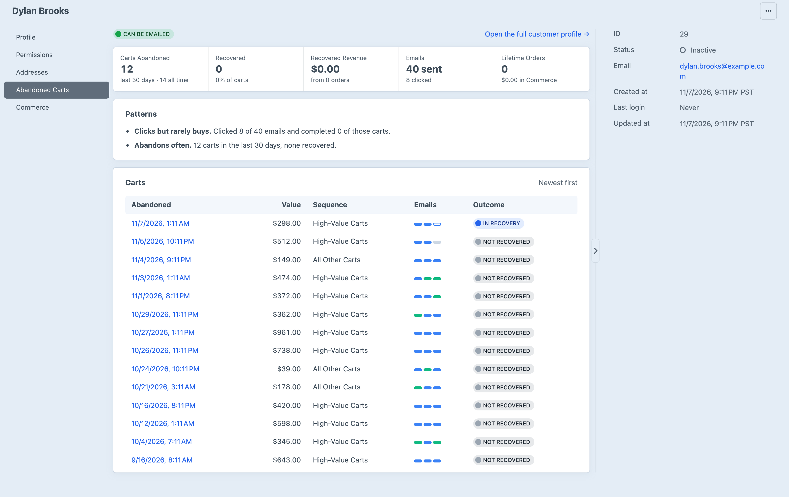

# Customers

When a customer gets in touch about cart reminders, or you want to see how one person shops, start with their customer record. Abandoned Cart keeps a record for each email address that has abandoned a cart, linked to the customer's Craft user account when they have one. The record holds whether the customer can be emailed, and brings together their carts, the emails they've received and what they've spent. You'll find them under **Abandoned Carts → Customers**.

## Email Statuses

Every customer has one of three statuses, which decides whether their carts are emailed:

- **Can be emailed** means the customer's carts can enter sequences, subject to your other settings.
- **Unsubscribed** means the customer used an unsubscribe link, or turned cart reminders off from their account on your site. Only the customer can reverse this, by opting in again at checkout or from their account, as [Unsubscribing](recovery-links.md#unsubscribing) explains. If your store offers neither, there's no way back, and you can tell the customer that their order confirmations aren't affected.
- **Do not email** means staff have asked Abandoned Cart never to email this address about carts.

Unsubscribed and Do not email both stop any recovery that's under way straight away, and the customer's later carts are recorded as skipped.

## Finding a Customer

Search the Customers screen by email address, or by the name on the customer's Craft user account. Guests are found by email address only. Use the sidebar to show everyone, or only customers who **Can be emailed**, have **Unsubscribed** or are on **Do not email**, with each one showing how many customers it holds.

Each customer's row shows their email status, with a detail such as when they unsubscribed, the note left when they were added to Do Not Email, or **In recovery now**. It also shows how many carts they've abandoned, how many were recovered, their recovery rate and recovered revenue, and when they last abandoned a cart.

## Customers Who Abandon Often

When customers have abandoned three or more carts in the last 30 days, a notice at the top of the Customers screen says how many. Sort by **Carts Abandoned** to find them. Someone who regularly fills a cart and leaves may be comparing prices, using the cart as a wishlist, or waiting for a discount, so they're worth a closer look before you send them more reminders. A customer's record points out the pattern too, as the next section describes.

## Seeing How a Customer Shops

Select a customer to open their record. It shows the carts they've abandoned in the last 30 days and all time, the carts recovered and the revenue they brought in, the emails they were sent and clicked, and their lifetime orders in Commerce. **Patterns** points out notable behaviour, such as a customer who often clicks but rarely buys, one who abandons often without a recovery, or one held back by the Contact Limit. Their carts are listed below, newest first, each linking to the cart's page, where [Following a Cart Through Recovery](carts.md#following-a-cart-through-recovery) explains what you'll see.

When the customer was emailed recently, the sidebar's **Next Sequence** says when they can next start a new sequence under the Contact Limit set in General Settings. For a customer with an account, **View in Commerce** opens their customer page in Commerce.

The same record appears on the customer's Craft user account, under **Users**, in a tab named after the plugin, so staff looking at an account can see the customer's cart history without leaving it. The tab links to the full record, and it's visible to anyone with the **Access Abandoned Cart** permission.

## Do Not Email

Use Do Not Email when a customer asks you directly to stop, such as by phone, or for an address that should never receive reminders, such as a staff member who places test orders. You'll need the **Manage Do Not Email** permission.

On a customer's record, enter an optional note in the sidebar's **Do Not Email Note**, such as "Asked by phone", then switch off **Can be emailed**. The note and the person who added it are shown there afterwards. To add several customers at once, select them on the Customers screen and choose **Add to Do Not Email**, which doesn't take a note. To block an address that hasn't abandoned a cart yet, open the **Do not email** view and choose **Add Address**.

You can also switch off **Can be emailed** in a cart's sidebar.

Customers can't change a Do Not Email status themselves, even from their account. Switching **Can be emailed** back on, on the customer's record or in a cart's sidebar, removes them from Do Not Email and gives them back the status they had before. A customer who had unsubscribed before being added stays **Unsubscribed**, with the date of their original unsubscribe, and their record says so while they're on Do Not Email. Everyone else can be emailed again. Carts that were skipped while they were on the list aren't revisited unless the customer changes one and leaves it again.

Do Not Email records are kept whatever the **Keep History For** setting, until the customer is deleted.

To stop emailing everyone at a domain, such as your own company's, add it to **Blocked Domains** under **Abandoned Carts → Settings → General Settings** instead.

## Consent

If the law where you trade requires customers to opt in before receiving marketing emails, add a Lightswitch field for consent and choose it as the **Consent Field** under **Abandoned Carts → Settings → General Settings**. Only customers who switched it on are emailed. Carts from everyone else are recorded as skipped, with the reason **Didn't opt in**.

The field is read from the order first, and then from the customer's user account when the order doesn't have the field. A customer counts as not having agreed when neither the order nor their account has the field.

Consent is read when the cart is abandoned, which is often before the customer reaches checkout. A checkbox that only appears at checkout therefore leaves many abandoned carts skipped. A preference in the customer's account settings, or a field they can switch on earlier, such as on the cart page, reaches more carts.

A consent field also gives unsubscribed customers a way back. When an unsubscribed customer completes an order with the consent field switched on for that order, their status returns to **Can be emailed**. A value already saved on their user account doesn't count, because their unsubscribe is the more recent choice. This only works when the field is on the order itself, which your developer sets up in Commerce's order fields, so checkout can offer it.

Developers who store consent elsewhere, such as in a newsletter service, can decide it with the [`resolveConsent` event](../developers/events.md#the-resolveconsent-event).

## Deleting a Customer

When a customer asks you to erase their personal details, delete their record. Open the action menu on their record, the button with three dots, and choose **Delete Customer**, then confirm. You'll need the **Delete customers** permission.

Deleting removes everything Abandoned Cart holds about the customer, including their email address, their status and Do Not Email note, every cart's recovery history, the emails they were sent, their clicks and their skipped carts. It can't be undone, and their carts leave the [recovery results](recovery-results.md).

It doesn't touch Commerce. Their orders, incomplete carts, addresses and user account stay where they are, so remove the customer's data from Commerce and Craft as well, following your usual process for erasure requests. Until their incomplete carts are gone, Abandoned Cart can pick a recent one up again as a new abandoned cart. A new record starts as **Can be emailed**, because their unsubscribe or Do Not Email status was deleted along with everything else.

## When Customers Complain About Reminders

A customer who asks you to stop emailing them can be added to [Do Not Email](#do-not-email), or pointed to the unsubscribe link at the bottom of any reminder. A customer who says they've already bought may have ordered under a different email address, because Abandoned Cart matches orders to customers by email address or user account. Their cart's page shows what happened, and **Stop Emails** ends that cart's reminders, as [Sending, Stopping and Retrying Emails](carts.md#sending-stopping-and-retrying-emails) explains.

When several customers say the emails come too often, look at the store-wide settings rather than individual customers. The **Contact Limit** in General Settings sets how long a customer waits between sequences, and each sequence's emails and delays decide how many reminders one cart gets.
