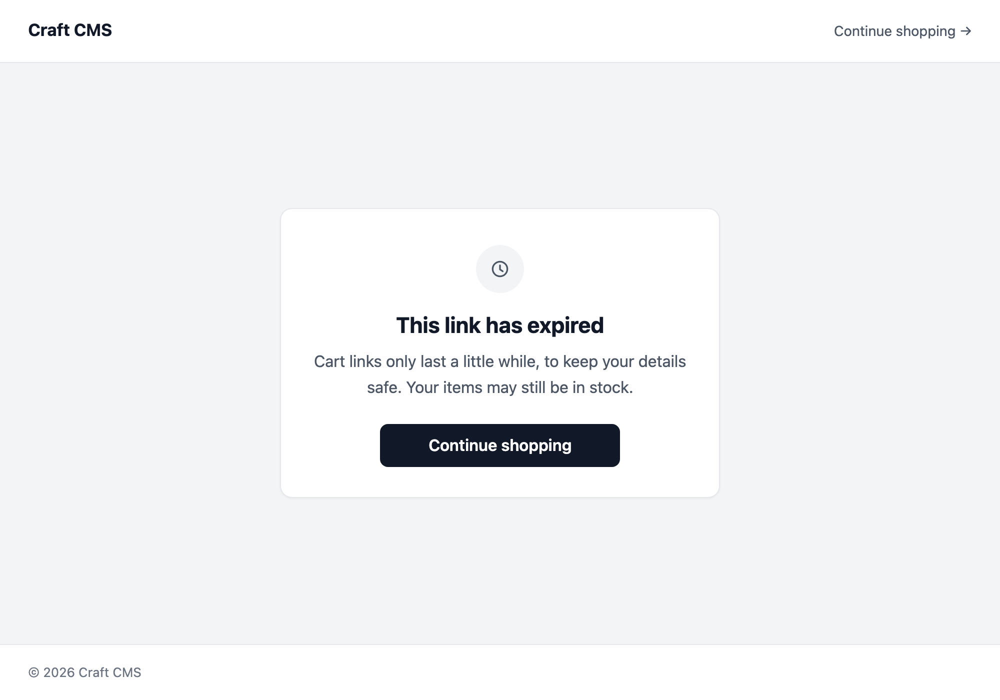
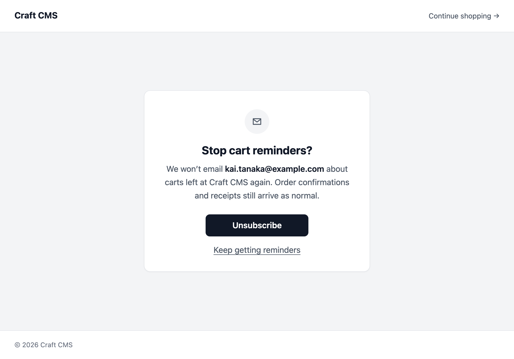

# Recovery Links

Every recovery email carries two links for the customer: a recovery link, behind the email's button, that brings their cart back, and an unsubscribe link that stops cart reminders. Knowing what each one does helps you set up the return page, explain the result to customers, and read the clicks in a cart's history.

## Restoring a Cart

When a customer follows a recovery link, Abandoned Cart puts their cart back into their browser session, so the items are waiting exactly as they left them. The restored cart replaces any other cart the browser had at the time. That other cart isn't deleted, and stays in Commerce, but the visitor is no longer shopping with it. If the email has a discount code, the code is applied to the cart at the same time. The customer then lands on the **Return Page**, usually your cart or checkout page, with a notice that reads "Welcome back. Your cart is just as you left it." [Restored Cart Notice](../template-guides/restored-cart-notice.md) explains how to display the notice in your cart template.

The click is recorded against the email the customer followed, and you'll see it in the cart's history. Following a link doesn't stop the sequence, so the cart's later emails still go out unless the customer completes an order or unsubscribes. It doesn't count as a change to the cart either, even when it applies a discount code, so the later emails keep their times. If the customer does order, the recovery is credited to the last email whose link restored their cart, as [Overview](overview.md#how-recoveries-are-credited) explains.

The Return Page comes from **Abandoned Carts → Settings → General Settings**, unless the cart's sequence overrides it. A relative path such as `shop/cart` is resolved against the site the cart belongs to.

### Carts That Belong to an Account

Emails are sometimes forwarded, and recovery links shouldn't reveal one customer's cart to someone else. When a cart belongs to a customer who can sign in to their account, the link only restores it for that customer. Anyone else, including the customer when they're signed out, is sent to your site's login page first and returns to the link once signed in. The login page is the one set by Craft's `loginPath` setting, or `login` when it's turned off, so your site needs a front-end login page at that path. Without one, account holders following a link see a page not found error. Carts from guest checkouts restore for whoever follows the link.

### When a Link Can't Restore the Cart

A recovery link works until the cart's recovery period ends, seven days after it was abandoned by default. In a few situations, the link shows a short page instead of restoring the cart:

| Page | When It Appears |
| --- | --- |
| This link has expired | The cart's recovery period has ended. |
| This order is already complete | The customer has already completed the order. |
| This cart is empty | The items have been removed from the cart since the email was sent. |
| This link isn't valid | The link is incomplete or altered, the cart no longer exists, or the site's security key has changed since the email was sent. |

Links are signed with Craft's security key, the `CRAFT_SECURITY_KEY` value in your environment, so they can't be guessed or altered. If that key changes, such as when the site moves to a new server with a new key, every recovery and unsubscribe link in emails already sent shows **This link isn't valid**. Keep the same key in production when you move or rebuild the server.

These pages return an HTTP error status, 404 for an invalid link and 410 for an expired one, which you may see in reports from link checkers or analytics. Each page has a button to continue shopping. Abandoned Cart shows these pages on their own by default. To show them inside your site's layout instead, choose a **Page Template** under **Customer Pages** in **Abandoned Carts → Settings → General Settings**. [Styling Customer Pages](../template-guides/styling-customer-pages.md) explains how.

## Unsubscribing

Every email includes an unsubscribe link. The bundled design puts it in the footer, and your own templates should include it too. Following it shows a page asking the customer to confirm that they want to stop cart reminders. Only confirming unsubscribes them, so spam filters and link scanners that open every link in an email can't unsubscribe anyone by accident.

Abandoned Cart also adds `List-Unsubscribe` and `List-Unsubscribe-Post` headers to each email. Mail apps such as Gmail and Yahoo use them to show an unsubscribe option next to the sender, which unsubscribes the customer in one click without opening a page. Large mailbox providers expect these headers from senders of marketing email.

Unsubscribing stops every cart reminder to that email address, across all sequences, and ends any recovery that's under way. It doesn't affect Commerce's order confirmations or other emails your store sends. The customer's status changes to **Unsubscribed** on the [Customers](customers.md) screen.

Staff can't undo an unsubscribe, and adding an unsubscribed customer to Do Not Email and removing them again leaves them unsubscribed. The customer can undo it themselves, in two ways. When a consent field is in use, completing an order with the field switched on for that order returns their status to **Can be emailed**. A value already saved on their user account doesn't count, because the unsubscribe is the more recent choice. [Consent](customers.md#consent) explains how the field is read. Customers with an account can also turn cart reminders off and on again from an account page on your site, if you add the form described in [Reminder Preferences](../template-guides/reminder-preferences.md).

On a store with neither a consent field nor the preferences form, an unsubscribed customer has no way to opt back in. If customers ask to get cart reminders again, add one of the two.

## Excluding the Links from Caching

Recovery and unsubscribe links are served from these paths on each site:

- `abandoned-cart/recover/<token>`, which restores the cart
- `abandoned-cart/unsubscribe/<token>`, which shows the unsubscribe page and records the unsubscribe
- `abandoned-cart-restore`, which handles links in emails sent by Abandoned Cart 4

Each one changes the visitor's session or the customer's record, so it must reach Craft on every visit. If your site uses full-page or static caching, or a CDN that caches HTML, exclude these paths from it.
