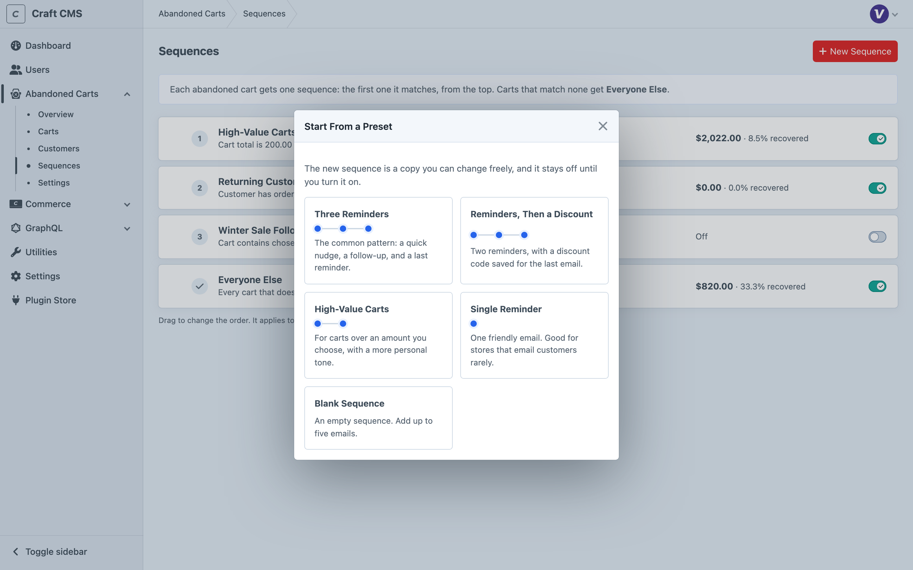

# Sequences

A sequence is a series of up to five emails that Abandoned Cart sends to a customer after they leave a cart. Each sequence decides who it's for, when each email goes out and what the emails say. You'll find them under **Abandoned Carts → Sequences**.

Most stores need only one sequence. Others want to treat some carts differently, with a more personal series for carts worth more than a certain amount, a gentler single reminder for repeat customers, or a discount only for first-time buyers. You can have as many sequences as you like, and each abandoned cart gets at most one of them.

## How Carts Choose a Sequence

When a cart is abandoned, Abandoned Cart checks it against your switched-on sequences from the top of the list down. The cart gets the first sequence whose audience it matches, and no other. Sequences that are switched off are passed over, and a cart that matches none of the others gets the default sequence at the bottom of the list.

Suppose your list has **High-Value Carts** (for carts of $200 or more), then **Returning Customers**, then **All Other Carts**, the default sequence. A returning customer who leaves $250 in their cart gets High-Value Carts, because it's higher in the list. Drag the sequences into the order you want. The new order applies to carts abandoned from then on.

The match happens once, when the cart is abandoned. If the customer later adds more items, the cart stays in the sequence it entered.

### When a Customer Leaves a Newer Cart

A customer has at most one cart in recovery at a time. When they leave a newer cart while an older one is still in recovery, the newer cart takes over the older cart's recovery instead of choosing a sequence of its own. It keeps the same sequence and the same times for the emails still to come, and those emails show what's in the newer cart. The older cart ends with the reason **Started a newer cart**.

The newer cart isn't checked against the sequence's audience or **Sites**, or against whether the sequence is still on. A customer whose first cart entered **High-Value Carts** carries on in that sequence even if their newer cart is worth less, because the customer, not the cart, is being followed. The checks on the customer still apply, so a newer cart from someone who has since unsubscribed is skipped as usual.

## The Default Sequence

The default sequence is always last in the list, marked with a tick, and takes every cart that reaches it. It can't be deleted or given an audience, but you can rename it or switch it off. With it off, a cart that doesn't match another sequence isn't emailed. It's recorded as skipped, with the reason **No sequence was on**.

A fresh install creates it as **All Other Carts**, with three emails, using the bundled email design. The first goes straight away once the cart is abandoned, the second a day later, and the third two days after that. It starts switched off so you can review it first. [Create Your First Sequence](../get-started/create-your-first-sequence.md) walks through that review.

## Turning a Sequence On and Off

Use the switch beside a sequence in the list, or **Sequence Is On** on its page. There's no separate publishing step, so what you've saved is what carts receive.

The sequence page's sidebar also shows how many carts are **In Recovery Now**, the sequence's recovered revenue and recovery rate for the **Last 30 Days**, and when it was **Last Changed**.

A sequence that's on takes carts that become abandoned from then on. A cart becomes abandoned once it has gone the **Abandoned After** time without changes. A cart that had already reached that point when you switched the sequence on isn't taken by it, and carries on down the list as if the sequence weren't there yet. Turning a sequence on therefore never sends reminders about a backlog of old carts. A cart that was still active, such as one changed ten minutes earlier with the default hour, is picked up once its hour passes. This also applies each time you switch a sequence back on after turning it off.

Turning a sequence off stops new carts from entering it, so a cart that would have matched it goes to the next matching sequence that's on, often the default. The sequence also holds the emails it hasn't sent yet. Those emails go out once it's back on, unless the customer has ordered or the cart's recovery period has ended in the meantime. If several emails for the same cart have become due while it was off, they're sent on the same run.

To stop every email from every sequence at once, use **Pause All Sending** instead. [Sending and Scheduling](sending-and-scheduling.md#pausing-all-sending) explains the difference.

## Audiences

**Who Gets This Sequence** sets the sequence's audience, meaning the carts it's for. Choose one of these:

- **All Carts** matches every abandoned cart with an email address. Because it takes every cart, sequences further down the list never receive any, unless **Sites** limits it to some of your sites.
- **Cart Value** matches carts whose total is at least an amount, less than an amount, or between two amounts. The total is the order total, including shipping, tax and discounts once the customer has chosen them. Until you enter an amount, it matches nothing.
- **Returning Customers** matches customers who have completed at least a set number of orders with the same email address.
- **First-Time Customers** matches customers with no completed orders, including guests.
- **Products** matches carts containing any, or all, of the products you choose. A variant in the cart counts as its product. Until you choose a product, it matches nothing.
- **Custom Rules** uses Commerce's order condition builder, so you can match any order condition Commerce offers, such as the total quantity, the shipping method, a coupon code or particular purchasables, along with the order's custom fields. A rule set with no rules matches every cart.

On a store that sells in more than one currency, the **Cart Value** amount is shown in your primary store's currency, but it's compared with each cart's total in that cart's own currency, without conversion. An amount of 200 matches a cart of 200 in any currency. If your stores' currencies differ much in value, give each store its own **Cart Value** sequence, limited to that store's sites with **Sites**.

Developers can add audiences of their own with the [`registerAudiences` event](../developers/events.md#the-registeraudiences-event), and they appear in the same list.

On a multi-site install, **Sites** limits the sequence to carts from the sites you tick. Leave every site unticked to include them all. An email's heading and message are written in one language, so a store with sites in several languages gives each language its own sequence and limits it to the matching sites. Subjects can also be translated with Twig, as [Emails and Email Templates](emails-and-email-templates.md#twig-in-subjects-and-preview-text) explains.

### Checking an Audience with a Real Cart

To check an audience before relying on it, use **Try It With a Real Cart** on the sequence page and choose one of the store's incomplete carts. Abandoned Cart tells you whether the cart matches and why, and warns you if a sequence higher in the list would take the cart first.

## Timing

A cart counts as abandoned once it has gone without changes for the **Abandoned After** time, an hour by default. Email 1's delay is counted from that moment, and each later email's delay is counted from the email before it. The sequence page's timeline shows the result, starting with **Cart abandoned**.

For example, with the default hour, a sequence whose emails are set to straight away, 1 day and 2 days sends them at these times:

| Email | Delay | Sent After the Last Cart Change |
| --- | --- | --- |
| Email 1 | Straight away | 1 hour |
| Email 2 | 1 day after email 1 | 1 day and 1 hour |
| Email 3 | 2 days after email 2 | 3 days and 1 hour |

Emails go out on the first background run after they're due, which is within five minutes when the run is scheduled with cron.

If the customer changes their cart while it's in recovery, such as by adding an item, its remaining emails move later by the time that has passed since the cart's previous change. They're still shopping, so the next reminder waits. Following a recovery link isn't a change, even when the link applies a discount code. Sending stops as soon as the customer completes any order, from this cart or another, or unsubscribes.

The whole sequence must fit within the **Recovery Ends After** time, seven days after the cart is abandoned by default. Emails that would fall after it are cancelled. The end of the recovery period stays where it was when the cart entered the sequence, even when later changes move its emails, so a cart that keeps changing can push its last emails past the end and lose them.

## Overriding the Recovery Defaults

Each sequence uses the Recovery Defaults from **Abandoned Carts → Settings → General Settings** unless you switch on **Override Recovery Defaults** on its page. You can then set a different **Abandoned After**, **Return Page**, **Recovery Ends After**, **Attribution Window** and **Contact Limit** for this sequence alone. [Configuration](../get-started/configuration.md#recovery-defaults) explains each one.

A longer recovery period is a common reason to override. A sequence with an email a week after abandonment needs more than the default seven days. A different return page suits a sequence for a particular product range. Like the default, the sequence's **Return Page** can be a relative path, a full URL or an environment variable reference.

When sequences have different **Abandoned After** times, a cart waits for the first sequence it matches rather than falling through to one further down that would take it sooner.

## Starting From a Preset

Choose **New Sequence** to create another sequence. You can start from a blank sequence or from a preset, which is a ready-made starting point with an audience, emails and wording.

Abandoned Cart comes with four presets:

| Preset | Audience | Emails |
| --- | --- | --- |
| Three Reminders | All Carts | Straight away, then 1 day and 2 days later |
| Reminders, Then a Discount | All Carts | Straight away, then 1 day and 2 days later, with discount wording in the last email |
| High-Value Carts | Cart Value, at least an amount you choose | Straight away, then 1 day later |
| Single Reminder | All Carts | One email, 3 hours after the cart is abandoned |

The new sequence is a copy that you can change freely. It's placed just above the default sequence and starts switched off.

Two presets need finishing before they're useful. **High-Value Carts** matches nothing until you enter its amount, and **Reminders, Then a Discount** mentions a code in its last email but leaves **Discount Code** empty for you to fill in with one of your Commerce coupon codes.

### Managing Presets

Presets are listed under **Abandoned Carts → Settings → Sequence Presets**, where admins can change any of them, add their own, put them in order or delete them. A preset holds a name, handle and description, an audience, and up to five emails, each with its timing, wording, email template, and whether it's the email for a discount. A cart value audience can hold its amount. A products or custom rules audience is chosen once the sequence exists, because those depend on your catalogue.

Presets are kept in project config, like email templates. Project config is saved with your site's code, so changes to presets are made on your development site and deployed with the rest of your project, and can only be made where admin changes are allowed. [What Moves Between Environments](../get-started/configuration.md#what-moves-between-environments) explains the difference from sequences, which are edited on each site. Editing a preset never changes sequences already made from it. Deleting all of them is fine, and **New Sequence** then offers a blank sequence only.

The emails in your presets also fill the **Start From** menu when you add an email to a sequence, as [Emails and Email Templates](emails-and-email-templates.md#adding-and-editing-emails) describes.

Developers can add presets from a plugin or module, or change or remove the ones from Settings, with the [`registerPresets` event](../developers/events.md#the-registerpresets-event). Presets added that way are listed under Settings as **Added by Plugins**, and can only be changed in code.

## Editing a Sequence in Use

Carts that are already in a sequence keep the audience and timing they entered with. Adding an email or changing an email's delay only affects carts that enter the sequence afterwards, while carts already in it carry on with their original schedule. Deleting an email is the exception, because carts already in the sequence won't receive the deleted email. Their other emails keep their times.

Changes to an email's subject, message, discount code or template reach every copy that hasn't been sent yet, including those for carts already in the sequence, so you can fix a typo without waiting for carts to work through.

Deleting a sequence deletes its emails too, so its carts receive nothing more from it. Those carts stay **In recovery** on the Carts screen until their recovery period ends, then move to **Not recovered**. Their history stays on the Carts and Customers screens.
