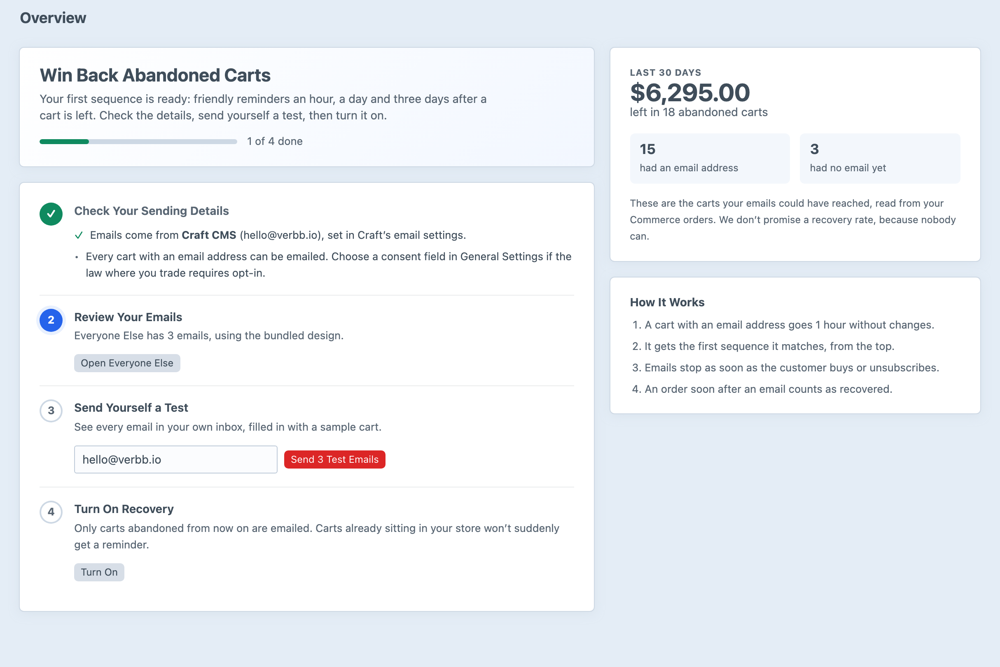
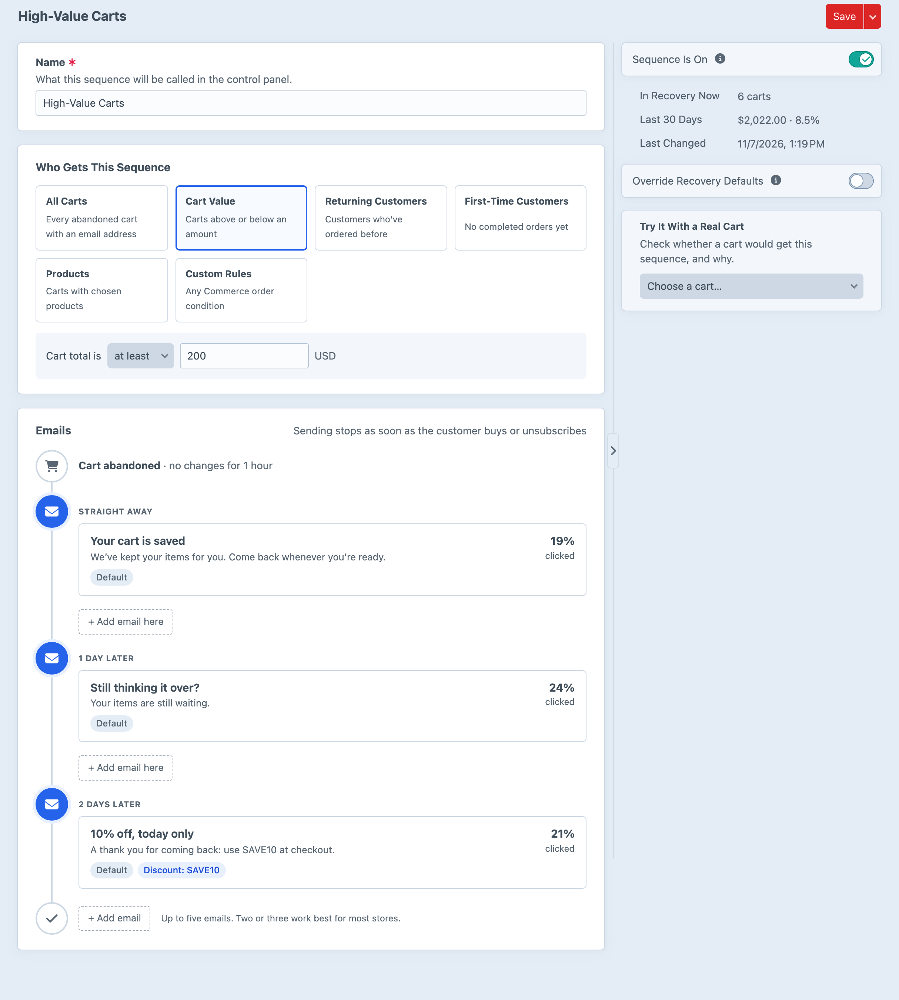

# Create Your First Sequence

A sequence is the series of emails a customer receives after leaving a cart. Installing Abandoned Cart creates one for you, the default sequence, called **All Other Carts**. It sends three friendly reminders, the first an hour after the cart is left, the second a day later and the third two days after that. It starts switched off, and this walkthrough takes you through setting it up and switching it on. You'll check how its emails are sent, review them, send yourself a test, switch the sequence on and then watch it email a cart of your own.

You'll need Abandoned Cart installed on a site running Craft Commerce, Craft's email settings configured so the site can send mail, and an admin account. Several steps use **Abandoned Carts → Settings → General Settings** and Craft's **Settings → Email**, which only admins can open.

Work through every step on a development or staging site where you can create carts of your own. Sequences, and whether each one is on, are stored in the site's database, so switching a sequence on in one environment leaves it off in the others. Once you're happy with the result, review the sequence and switch it on in production too.

## Check Your Sending Details

Open **Abandoned Carts → Overview**. Until a sequence is switched on, the Overview shows a short setup checklist, and its first step summarises how emails will be sent.



Recovery emails go out through Craft's mailer, using the sender name and address from Craft's **Settings → Email**. If the address shown isn't the one customers should see, change it there.

The checklist also tells you whether a consent field is in use. Without one, every abandoned cart with an email address can be emailed. If the law where you trade requires customers to opt in to marketing emails, add a Lightswitch field to your checkout (on the order or the customer's account) and choose it as the **Consent Field** under **Abandoned Carts → Settings → General Settings**. Only customers who switched it on are emailed. [Customers](../feature-tour/customers.md#consent) explains how the field is read.

While you're in **General Settings**, check two more fields. **Return Page** is where a recovery link takes the customer once their cart is restored, and it starts as `shop/cart`. If your store's cart page lives at another path, such as `cart` or `checkout`, enter that path instead and save. **Pause All Sending** must be off for the test later on. If it's switched on, or the field shows a warning because `deliveryPaused` is set in `config/abandoned-cart.php` for this environment, emails wait instead of sending.

## Schedule the Background Run

Abandoned Cart works through carts in a short background run. It finds carts that have gone quiet, starts their sequences and sends any emails that are due. Run it every five minutes from cron, using the PHP executable and Craft project path for your server:

```shell
*/5 * * * * /path/to/php /path/to/project/craft abandoned-cart/recoveries/run
```

You don't need to work out those paths yourself. **Abandoned Carts → Settings → System Status** shows this cron line with the paths filled in for the server it's running on, along with a **Copy cron job** button.

If you can't add a cron job, Abandoned Cart queues a run from ordinary site and control panel traffic instead, as long as Craft's queue is running. Cron keeps the timing regular on quiet sites, so prefer it where you can. A development site often has neither, and that's fine for this walkthrough, because the final check starts the run by hand. [Sending and Scheduling](../feature-tour/sending-and-scheduling.md) covers both options.

## Review the Emails

Choose **Review the Emails** in the checklist, or go to **Abandoned Carts → Sequences** and select **All Other Carts**. The sequence page shows who gets the sequence and a timeline of its emails. For All Other Carts, the cart is abandoned after an hour without changes, email 1 goes out straight away, email 2 a day later and email 3 two days after that.

Every sequence page has the same layout. This example is a sequence for high-value carts, with a discount code in its last email:



Select an email to open it. You can change its subject, preview text, heading, message and button label, and insert tokens such as `{firstName}` to personalise them. The preview beside the fields updates as you type, using a sample cart. Save each email you change. Once you've changed one, the checklist marks this step done. [Emails and Email Templates](../feature-tour/emails-and-email-templates.md) explains every field.

If you'd like the last email to include a discount, create a discount with a coupon code in Commerce first. Then open the email and choose that code in its **Discount Code** field, or type it if it isn't listed. Customers who return through that email have the code applied to their cart.

## Send Yourself a Test

Back on the Overview, the **Send Yourself a Test** step has an email field that starts with your account's address. Change it if you'd like the tests to go elsewhere, then select **Send 3 Test Emails**. You'll receive every email in the sequence, each with `[Test]` at the start of its subject and filled in with a sample cart. Links in test emails are placeholders, so they don't restore anything.

Check that the emails arrive, that the sender looks right, and that the wording reads well on your phone as well as your desktop. If nothing arrives, use the **Test** button in Craft's **Settings → Email** and check your mail provider's logs before going further.

## Turn On Recovery

Choose **Turn On** in the checklist. You can also switch on **Sequence Is On** on the sequence's page and select **Save**. From that moment, carts that become abandoned on your store are emailed. Carts that had already been abandoned before you turned it on are left alone, so long-forgotten carts don't suddenly receive a reminder.

The Overview changes to show that recovery is on. Once customers start coming back, it fills with results.

## Check It Works

On the same development or staging site, add a product to a cart, enter an email address you can read at checkout, then leave the order incomplete. Don't touch the cart again, because a cart counts as abandoned once it has gone an hour without changes. To try this without waiting, temporarily set **Abandoned After** to a minute or two in **Abandoned Carts → Settings → General Settings**.

When the time has passed, start the background run yourself. Either select **Run Now** under **Abandoned Carts → Settings → System Status**, or run this command from your Craft project directory:

```shell
php craft abandoned-cart/recoveries/run
```

The command prints a summary such as `Enrolled 1, skipped 0, sent 1, failed 0, not sent 0, ended 0.` Because email 1 is set to go out straight away, it's sent in the same run. Open **Abandoned Carts → Carts** and you'll see the cart **In recovery**, with its next email scheduled.

Open the email and follow its button. Your browser lands on your **Return Page** with the same items in the cart, and the cart's history in the control panel records the click. Complete the order, and the cart moves to **Recovered**, credited to the email you followed.

If the run reports a cart as skipped, open it from the **Skipped** view on the Carts screen. It shows the reason, such as a missing consent or a recent email to the same customer. If nothing is enrolled at all, check that the cart has an email address and items, that it's still incomplete, and that enough time has passed since it last changed. If the cart is in recovery but no email was sent, check that **Pause All Sending** is off.

Remember to restore **Abandoned After** if you changed it. From here, you can add sequences for particular customers or carts, such as a separate series for high-value carts. [Sequences](../feature-tour/sequences.md) explains how carts are matched to them.
