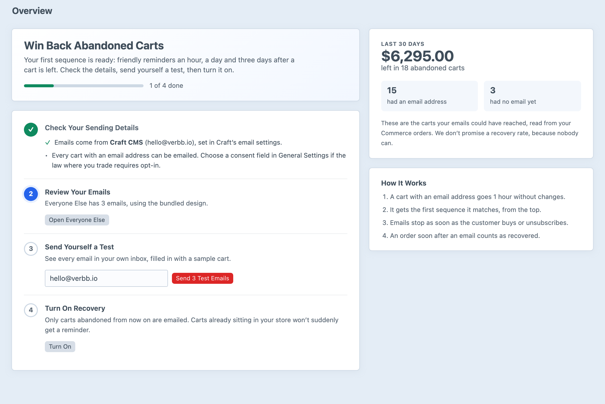
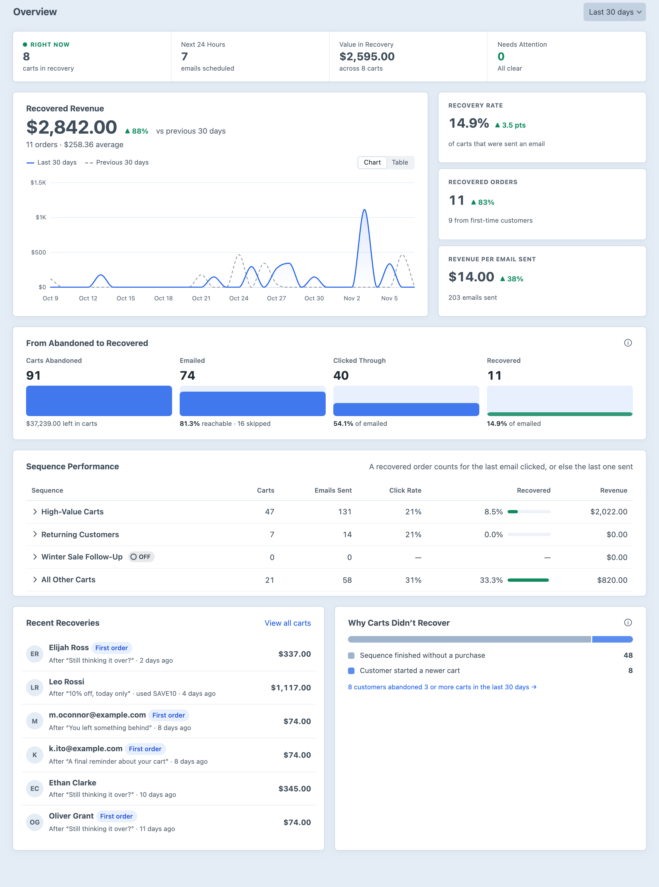
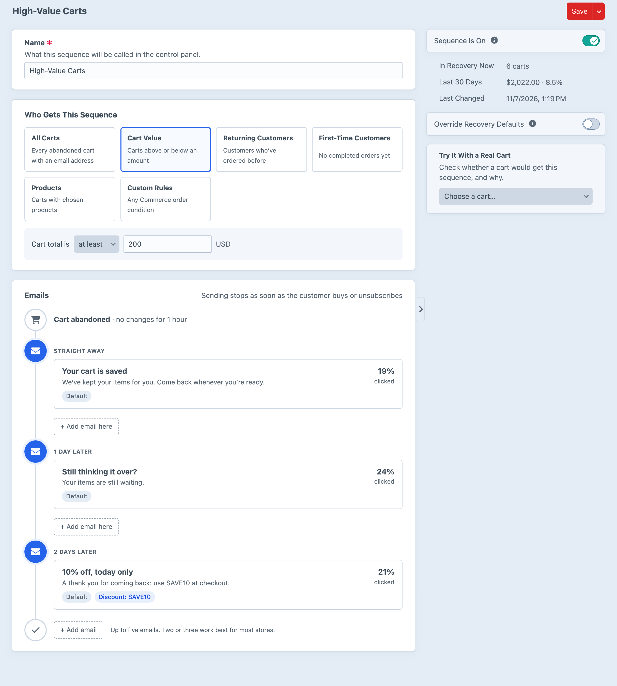
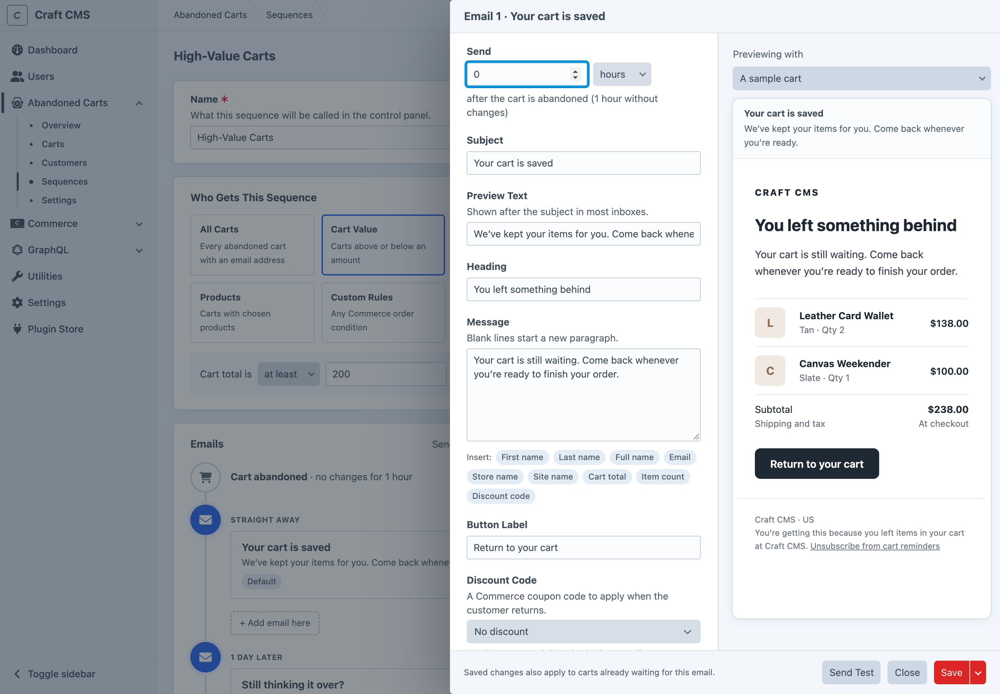
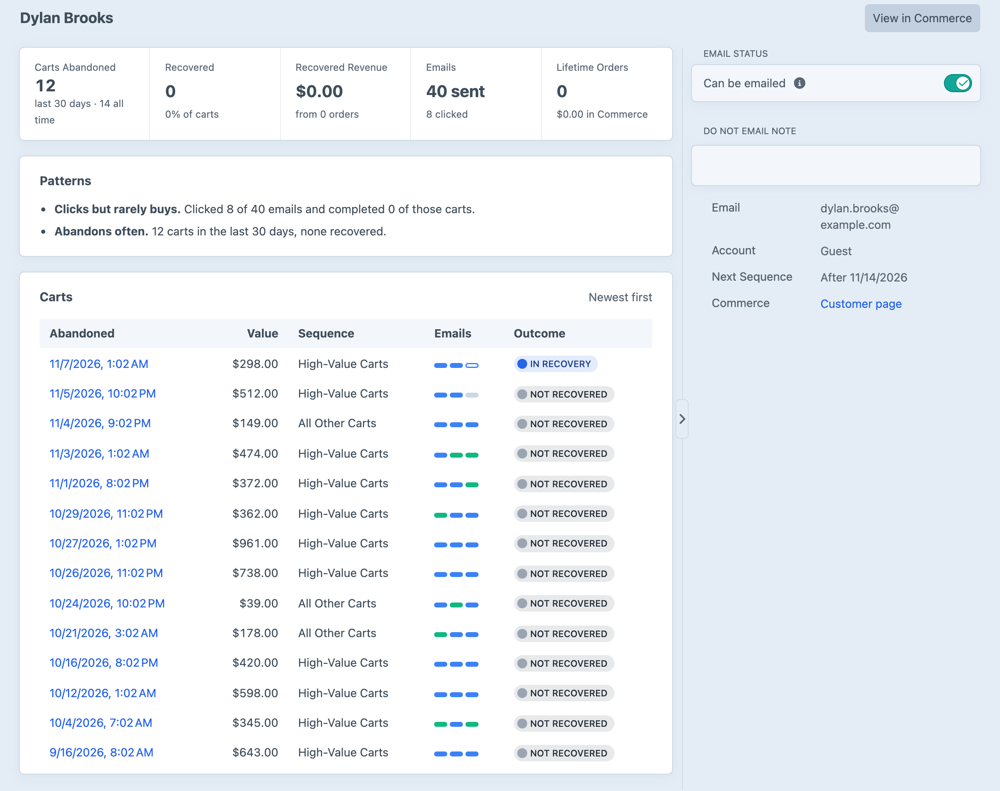

<!-- feature-intro -->
Abandoned Cart wins back Craft Commerce sales by emailing customers about the carts they left behind and bringing them straight back to checkout. Start with a ready-made sequence of reminders, send different emails to the carts that deserve them, and see exactly what recovery earns your store.
<!-- feature-intro-end -->

<!-- feature-section media-size="large" -->
## Recover abandoned carts

A customer fills a cart, gets distracted and wanders off. Abandoned Cart follows up with a short series of reminders, each with a button that puts the cart back exactly as they left it. The emails stop as soon as they order or unsubscribe, so nobody is chased about something they've already bought.

There's nothing to build first. A three-email sequence comes ready to go, and the Overview walks you through a test send before you switch it on. Only carts abandoned from then on are emailed, so old carts are left alone.

<!-- feature-section-end -->

<!-- feature-section media-size="medium" -->
## See what recovery earns

Recovered revenue, recovery rate and revenue per email are compared with the period before, so you can tell whether a change to your emails paid off. A funnel follows carts from abandoned to recovered, and Sequence Performance shows which emails bring customers back and whether a later one earns its place.

Only orders completed after a reminder count, so the results aren't padded with sales you'd have made anyway.

<!-- feature-section-end -->

<!-- feature-media -->
## Send a different sequence to the carts that need it

Most stores do well with one sequence. When some carts deserve something else, add another, such as a more personal series for carts of $200 or more, a gentler nudge for returning customers, or a discount only for first-time buyers. Target by cart value, customer history, products or any Commerce order condition.

Start from a preset, then use Try It With a Real Cart to see which sequence one of your carts would get, and why, before you switch it on.

<!-- feature-media-end -->

<!-- feature-media -->
## On-brand emails without the template work

Write the subject, preview text, message and button in the control panel, with tokens like `{firstName}` and `{cartTotal}` for each customer's details. The preview updates as you type, using a sample cart or a real one, and you can send yourself a test before any customer sees it.

The bundled design shows the cart's items, any discount code and a button back to checkout, with no templates to maintain. When it needs to match your store's other mail, point it at your own Twig templates.

<!-- feature-media-end -->

<!-- feature-media -->
## Follow every cart

The Carts screen shows every abandoned cart with its sequence, progress and status. Open one to see its journey, from each email and click through to the order and the email that earned it. Carts that were never emailed show why, such as a customer who didn't opt in.

When a cart needs a person, staff can send the next email now, stop the emails or retry one that failed.

<!-- feature-media-end -->

<!-- feature-media -->
## Know who you're emailing

Every email address that abandons a cart gets a customer record, linked to their Craft account when they have one. See their carts, clicks, recovered revenue and lifetime orders in one place, along with patterns worth noticing, like a customer who often clicks but rarely buys.

Staff can add anyone to Do Not Email with a note, and the same profile appears on their Craft user account.

<!-- feature-media-end -->

<!-- feature-grid -->
- :icon[discount] **Discounts on return** Add a Commerce coupon code to an email, and it's applied to the cart when the customer comes back through that email's link.
- :icon[lock] **Links that respect accounts** A cart that belongs to an account only restores for its owner once they've signed in, so a forwarded email can't reveal someone else's cart.
- :icon[mail-off] **One-click unsubscribe** Every email includes the headers Gmail and Yahoo use for their unsubscribe button, with a confirmation page link scanners can't trigger.
- :icon[user-check] **Reminders customers control** Signed-in customers can turn cart reminders off and on again from their account page once you add the form to your templates.
- :icon[shield-check] **Consent built in** Email only customers who opted in through a consent field, block whole domains, or limit reminders to returning customers.
- :icon[clock-pause] **No reminder pile-ups** A contact limit keeps customers who abandon often from starting a new sequence while a recent email is still fresh.
- :icon[language] **Multilingual stores** Limit sequences to the sites they suit, and translate subjects with Twig, rendered in the language of each customer's order.
- :icon[key] **Access by role** Separate permissions for sequences and sending, Do Not Email and System Status let each person do their part.
- :icon[code] **Developer events** Add your own audiences and presets, or step into consent, recovery links, rendering and sending.
<!-- feature-grid-end -->

<!-- feature-media -->
## Know your reminders are going out

A cron job every five minutes sends what's due, or Craft's queue takes over on sites without cron. Failed emails are retried automatically, and anything that still fails shows up in System Status, which checks scheduling, sending, templates and consent in one place.

If something goes wrong mid-campaign, Pause All Sending holds every email. The same config setting keeps development and staging sites from emailing real customers.

<!-- feature-media-end -->
