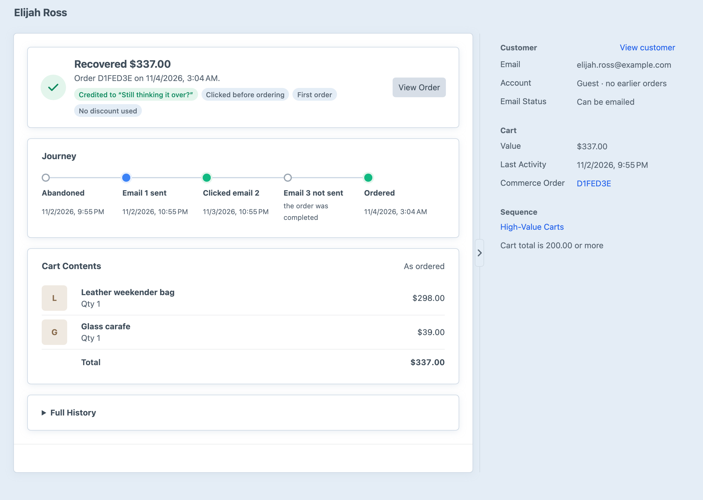
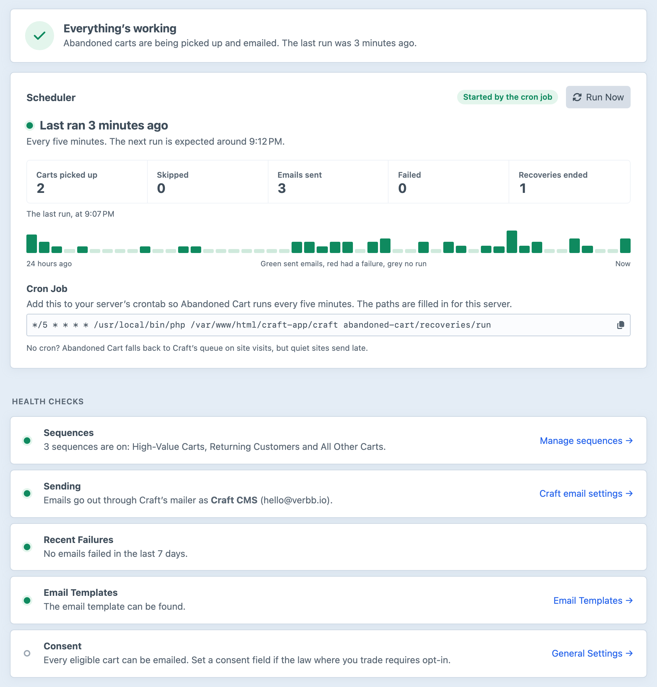

<!-- feature-intro -->
Abandoned Cart wins back Craft Commerce sales by emailing customers about the carts they left behind and bringing them straight back to checkout. Start with a ready-made sequence of reminders, send different emails to the carts that deserve them, and see exactly what recovery earns your store.
<!-- feature-intro-end -->

<!-- feature-section media-size="large" -->
## Recover abandoned carts

A customer fills a cart, gets distracted and wanders off. Once the cart has gone quiet, Abandoned Cart sends a short series of reminders, each with a button that puts the cart back exactly as they left it. The emails stop as soon as the customer orders or unsubscribes, so nobody is chased about something they've already bought.

There's nothing to build before you begin. A fresh install includes All Other Carts, a three-email default sequence in a responsive bundled design, and the Overview walks you through checking your sending details, reviewing the emails, sending yourself a test and switching recovery on. Only carts abandoned from then on are emailed, so turning it on never fires reminders at a backlog of old carts.

<!-- feature-section-end -->

<!-- feature-section media-size="medium" -->
## See what recovery earns

Recovered revenue, recovery rate, recovered orders and revenue per email sent are each compared with the period before, so you can tell whether a change to your emails made a difference. A funnel follows carts from abandoned to emailed, clicked and recovered, and Why Carts Didn't Recover points to the setting worth reviewing when one reason stands out.

Sequence Performance compares your sequences and the emails inside them, showing where customers come back and whether a later email earns its place. An order counts as recovered when it's completed within the attribution window after an email, even if the customer typed your address instead of clicking. Orders completed before any email was sent don't count, so the results aren't padded with sales you'd have made anyway.

<!-- feature-section-end -->

<!-- feature-media -->
## Different carts, different emails

Most stores do well with one sequence. When some carts deserve something else, add another, such as a more personal series for carts of $200 or more, a gentler reminder for returning customers, or a discount only for first-time buyers. Target a sequence by cart value, returning or first-time customers, the products in the cart or any Commerce order condition, and limit it to particular sites.

Each cart gets the first sequence it matches from the top of the list, and the default sequence catches the rest. Start from a preset, set up to five emails on a timeline, then use Try It With a Real Cart to check which sequence one of your store's carts would get, and why, before you switch it on.

<!-- feature-media-end -->

<!-- feature-media -->
## On-brand emails without the template work

Write each email's subject, preview text, heading, message and button label in the control panel. Tokens such as `{firstName}` and `{cartTotal}` fill in each customer's details, and the preview beside the fields updates as you type, using a sample cart or one of your store's real carts. Send yourself a test before any customer sees it.

The bundled design shows the items in the cart, the discount code when there is one and a button back to checkout, with no template files to maintain. When your emails need to match the rest of your store's mail, point an email template at your own Twig files, or copy the bundled design as a starting point.

<!-- feature-media-end -->

<!-- feature-media -->
## Follow every cart

The Carts screen lists every abandoned cart with its sequence, progress and status. Open one to see its journey: each email, any clicks and the order, along with the email the recovery was credited to and whether it was the customer's first order. Carts that were never emailed are listed too, with the reason, such as a customer who didn't opt in or was emailed recently about another cart.

When a cart needs a person, staff can send the next email straight away, stop the emails for that cart, or retry an email that failed to send.

<!-- feature-media-end -->

<!-- feature-media -->
## Know who you're emailing

Every email address that abandons a cart gets a customer record, linked to their Craft user account when they have one. See their carts, emails sent and clicked, recovered revenue and lifetime orders in one place, along with patterns worth noticing, such as a customer who often clicks but rarely buys. Customers who abandoned three or more carts in the last 30 days are sorted to the top of the list.

Customer service staff can add anyone to Do Not Email with a note, such as "Asked by phone", and the same profile appears as a tab on the customer's Craft user account.

<!-- feature-media-end -->

<!-- feature-grid -->
- :icon[discount] **Discounts on return** Add a Commerce coupon code to an email, and it's applied to the cart when the customer comes back through that email's link.
- :icon[lock] **Links that respect accounts** A cart that belongs to an account only restores for its owner once they've signed in, so a forwarded email can't reveal someone else's cart.
- :icon[mail-off] **One-click unsubscribe** Every email carries the headers Gmail, Yahoo and other mail apps use for their unsubscribe button, plus a confirmation page that link scanners can't trigger by accident.
- :icon[user-check] **Reminders customers control** Signed-in customers can turn cart reminders off and on again from their account page once you add the form to your templates.
- :icon[shield-check] **Consent built in** Email only customers who opted in through a consent field, block whole domains, or limit reminders to returning customers.
- :icon[clock-pause] **No reminder pile-ups** A contact limit keeps customers who abandon often from starting a new sequence while a recent email is still fresh.
- :icon[language] **Multilingual stores** Limit sequences to the sites they suit, and translate subjects with Twig, rendered in the language of each customer's order.
- :icon[key] **Access by role** Separate permissions for sequences and sending, Do Not Email and System Status let each person do their part.
- :icon[code] **Developer events** Add your own audiences and presets, or step into consent, recovery links, rendering and sending.
<!-- feature-grid-end -->

<!-- feature-media -->
## Sending you can rely on

Schedule a short background run every five minutes with cron to start sequences and send what's due, or let sites without cron fall back to Craft's queue. When the mailer reports a failure, the email is retried automatically, and anything that still fails shows up on the Overview and in System Status.

System Status checks the scheduler, sending, recent failures, email templates and consent in one place. If something goes wrong mid-campaign, Pause All Sending holds every email until you're ready, and the same setting in your config file keeps development and staging copies of your store from emailing real customers.

<!-- feature-media-end -->
